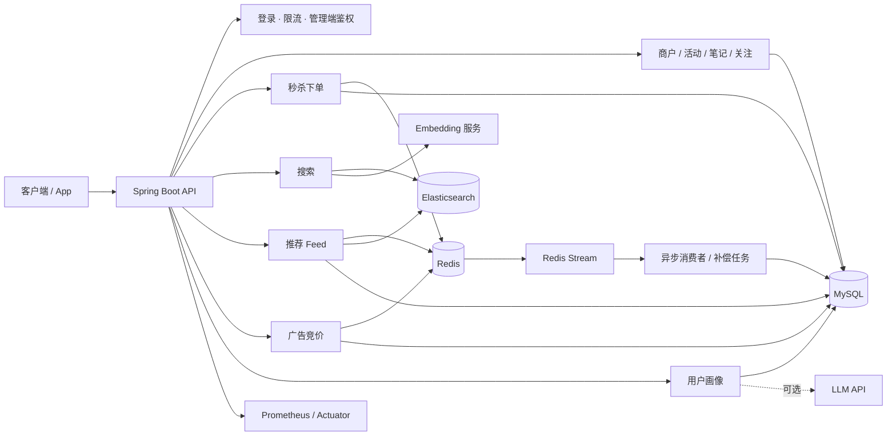

# 智搜推广告推荐系统

> 本地生活搜索 · 推荐 · 广告 · 画像一体化平台

<p>
  
  
  
  
  
  
</p>

一个面向本地生活场景的**搜索 + 推荐 + 广告 + 用户画像**一体化后端。项目以高并发交易能力为底座，覆盖商户与活动、探店笔记、关注、优惠券秒杀，并在此基础上扩展出 Elasticsearch 混合检索、多路召回推荐 Feed、实时广告竞价和 AI 用户画像，形成从内容生产、流量分发到商业变现的完整闭环。

## 核心特性

- **高并发秒杀**：Redis Lua 分段库存 + 一人一单 + Redis Stream 异步下单，配合幂等表、死信流、动态线程池、令牌桶限流与定时对账，保证不超卖、不重复、可补偿。
- **混合搜索**：Elasticsearch 倒排检索 + kNN 向量召回，独立的 Python embedding 服务（BGE 中文小模型），query 向量缓存与超时降级，embedding 不可用时自动回退纯倒排。
- **推荐 Feed**：关注 / 热门 / 地理 / 标签 / 向量 / 精选多路召回，粗排 → 精排 → 重排三级排序，Caffeine L1 + Redis L2 两级缓存，单路超时隔离与冷启动策略。
- **实时广告竞价**：Redis 倒排定向、用户/广告/IP 频控、总预算 + 日预算双预算 Lua 扣减、CTR 分段校准、eCPM 一价竞价、Feed 固定广告位、异步计费与延迟反馈。
- **AI 用户画像**：自然行为与广告行为分离聚合，LLM 异步生成兴趣标签与语义查询，失败时结构化降级；画像同时供推荐召回和广告定向消费。
- **可观测性**：Micrometer + Prometheus 指标、traceId 全链路日志、Actuator 健康检查、管理端运维接口。

## 技术栈

| 层次 | 技术 |
|---|---|
| 语言 / 构建 | Java 8、Maven |
| 应用框架 | Spring Boot 2.7.18、Spring MVC、MyBatis-Plus 3.5.3、Lombok、Hutool |
| 数据存储 | MySQL 8.0、Redis 7（Lettuce + Redisson） |
| 搜索引擎 | Elasticsearch 8.11.4（倒排 + kNN），官方 Java Client |
| 消息与异步 | Redis Stream（默认）、RabbitMQ（可选回退模式）、Spring `@Async` / 有界线程池 |
| 本地缓存 | Caffeine |
| AI 能力 | FastAPI + sentence-transformers + `BAAI/bge-small-zh-v1.5`（512 维）；LLM 走 OpenAI-compatible 接口，可选 |
| 可观测 | Micrometer、Prometheus、Actuator、自定义 traceId |
| 部署 | Docker Compose（MySQL / Redis / ES / embedding） |

## 系统架构



### 核心链路

```text
秒杀
  POST /voucher-order/seckill/{id}
    → 令牌桶限流（user / ip / api）
    → seckill_segment.lua：时间窗校验 → 售罄标记 → 一人一单 → 分段扣库存 → XADD
    → 立即返回 requestId
    → Stream 消费组 → 幂等表 + DB 条件扣减 + 唯一索引
    → 成功 ACK；失败重试；超限进入死信流 + 失败补偿表
    → 定时对账，发现不一致仅告警

搜索
  POST /search/activity
    → query 向量缓存（Redis，1h）
    → embedding 编码（硬超时，超时降级）
    → ES 倒排 + kNN 混合检索
    → 热点权重衰减 + 结果组装
    → 返回 degraded / vectorDegraded / queryVectorCacheHit 标记

推荐
  GET /recommend/feed
    → L1 Caffeine → L2 Redis
    → FOLLOW / HOT / GEO / TAG / VECTOR / CURATED 并行召回（单路超时隔离）
    → 粗排 Top100 → 精排加权 → 重排打散
    → 固定广告位插入
    → 异步曝光埋点

广告
  POST /ad/auction
    → Redis 倒排定向（标签 / 类目 / 城市 / 设备 / 时段）
    → pCTR 预估 + 分段保序校准
    → eCPM = pCTR × bid × quality × 1000
    → budget_deduct.lua：频控 + 总/日预算 + 幂等扣减
    → 一价计费 + 曝光/点击/转化流水 + 延迟反馈
```

## 功能模块

| 模块 | 能力 |
|---|---|
| 用户 | 验证码登录、Token 续期、登出、签到、签到统计、用户信息 |
| 商户与内容 | 商户查询与缓存、商户类型、探店笔记、点赞排行榜、评论、关注/共同关注 |
| 活动 | 活动主表、按商户/类目查询、活动详情、管理端增删改查 |
| 秒杀 | 库存分段、一人一单、异步下单、消费幂等、死信补偿、限流、对账、回滚 |
| 搜索 | 活动索引、倒排 + 向量检索、热搜、索引增量消费、索引重建、热度衰减 |
| 推荐 | 多路召回、粗排/精排/重排、两级缓存、曝光去重、事件埋点、兴趣向量 |
| 广告 | 广告主/计划、定向、频控、预算、CTR 校准、竞价、固定位、计费、转化回传、看板 |
| 画像 | 行为聚合、LLM 异步画像、兴趣标签、语义查询、广告偏好、标签编辑、匿名画像 |
| 基础设施 | 全局异常、traceId、限流拦截器、管理端鉴权、GEO 预加载、Redis 重建任务 |
| 可观测 | Actuator、Prometheus 指标、指标导出脚本、压测脚本与报告 |

## 目录结构

```text
.
├── src/main/java/com/hmdp
│   ├── controller/            # 用户、商户、笔记、关注、活动、秒杀等接口
│   ├── service/               # 业务服务
│   │   └── recommend/         # 召回、粗排、精排、重排、Feed 缓存
│   ├── ad/                    # 广告定向、CTR、预算、竞价、计费
│   ├── profile/               # 用户画像与 LLM 异步生成
│   ├── search/                # ES 检索、索引、embedding 客户端
│   ├── mq/                    # Redis Stream / RabbitMQ 生产者与消费者
│   ├── geo/                   # GEO 索引预加载与启动重建
│   ├── interceptor/ filter/   # 登录、限流、管理端鉴权、traceId
│   ├── config/ metrics/       # 配置与监控指标
│   └── utils/                 # 缓存、锁、Redis 常量、工具类
├── src/main/resources
│   ├── db/                    # hmdp 基础库 + 秒杀/搜索/推荐/广告/画像增量 SQL
│   ├── lua/                   # 秒杀、限流、广告预算/频控/定向脚本
│   └── application*.yaml      # 本地与 Docker 配置
├── embedding-service/         # Python FastAPI 向量编码服务
├── loadtest/                  # JMeter / Python 压测与冒烟脚本
├── monitoring/                # Prometheus 配置与指标导出
└── docs/                      # 设计说明、阶段报告、压测与回滚方案
```

## 快速开始

### 1. 环境要求

- JDK 8+
- Maven 3.6+
- Docker 与 Docker Compose
- 建议内存 16 GB（同时运行应用、MySQL、Redis、ES、embedding）

### 2. 启动中间件

```bash
docker compose up -d mysql redis elasticsearch embedding
```

| 服务 | 宿主机端口 | 说明 |
|---|---:|---|
| MySQL | 3307 | 库名 `hmdp`，root 密码 `123456` |
| Redis | 6379 | Stream 模式必需 |
| Elasticsearch | 9201 | 单节点，关闭安全认证 |
| Embedding | 8090 | 首次启动下载约 95 MB 模型 |
| 应用 | 8081 | Spring Boot |
| Prometheus | 9090 | 可选，见 `monitoring/` |

> RabbitMQ 不在默认 Compose 中。秒杀默认使用 Redis Stream（`hmdp.seckill.mq=stream`），无需 RabbitMQ；仅回退到 Rabbit 模式时才需要。

### 3. 初始化数据库

Compose 首次启动会按文件名顺序自动执行全部脚本：

```text
hmdp.sql → seckill_p3.sql → seckill_p6.sql → zs_p1.sql → zs_p1_seed.sql
→ zs_p2_synthetic.sql（800 条演示活动）→ zs_p3.sql → zs_p4.sql → zs_p5.sql → zs_p6.sql
```

如需在已有 MySQL 实例上手动初始化，按同一顺序执行：

```bash
for f in hmdp seckill_p3 seckill_p6 zs_p1 zs_p1_seed zs_p2_synthetic zs_p3 zs_p4 zs_p5 zs_p6; do
  docker exec -i zs-mysql mysql -uroot -p123456 hmdp < "src/main/resources/db/$f.sql"
done
```

> 注意：`zs_p1.sql` 包含 `ALTER TABLE`，重复执行前需确认列是否已存在；首次初始化无需处理。不使用合成数据时可跳过 `zs_p2_synthetic.sql`。

### 4. 启动应用

```bash
# 使用 application-docker.yaml（MySQL 指向 3307）
mvn spring-boot:run -Dspring-boot.run.profiles=docker
```

或打包后启动：

```bash
mvn clean package -DskipTests
java -jar target/zhisoutui-0.0.1-SNAPSHOT.jar --spring.profiles.active=docker
```

### 5. 验证

```bash
curl http://127.0.0.1:8081/actuator/health
curl "http://127.0.0.1:8081/shop-type/list"
curl -X POST "http://127.0.0.1:8081/search/activity" \
  -H "Content-Type: application/json" \
  -d '{"keyword":"西湖 火锅","page":1,"size":10}'
curl "http://127.0.0.1:8081/recommend/feed?size=10"
curl -X POST "http://127.0.0.1:8081/ad/auction" \
  -H "Content-Type: application/json" \
  -d '{"city":"杭州","deviceId":"demo-device","slots":[3,6]}'
```

## 接口一览

| 分组 | 路径 | 说明 |
|---|---|---|
| 用户 | `/user/code`、`/user/login`、`/user/logout`、`/user/me`、`/user/sign` | 登录、Token、签到 |
| 商户 | `/shop/{id}`、`/shop/of/type`、`/shop/of/name`、`/shop-type/list` | 商户查询与分类 |
| 内容 | `/blog`、`/blog/hot`、`/blog/like/{id}`、`/blog/likes/{id}`、`/blog/of/follow` | 笔记、点赞、关注流 |
| 关注 | `/follow/{id}/{isFollow}`、`/follow/common/{id}` | 关注与共同关注 |
| 活动 | `/activity/{id}`、`/activity/of/shop/{shopId}`、`/activity/list` | 活动查询 |
| 秒杀 | `/voucher-order/seckill/{id}`、`/voucher/list/{shopId}` | 秒杀下单与券列表 |
| 搜索 | `/search/activity`、`/search/hot` | 混合检索与热搜 |
| 推荐 | `/recommend/feed`、`/recommend/event` | Feed 与行为埋点 |
| 广告 | `/ad/auction`、`/ad/click`、`/ad/conversion` | 竞价、点击、转化 |
| 画像 | `/user/profile`、`/user/profile/tags` | 画像查询与标签编辑 |
| 管理端 | `/admin/activity`、`/admin/geo/rebuild`、`/admin/search/*`、`/admin/recommend/*`、`/admin/ad/*`、`/admin/profile/*` | 运维与运营接口 |

管理端请求需携带请求头 `X-Admin-Token`，默认值通过 `HMDP_ADMIN_TOKEN` 配置（本地默认 `zs-admin-local`）。

## 配置说明

主要配置集中在 `src/main/resources/application.yaml` 的 `hmdp.*` 下：

| 配置前缀 | 作用 |
|---|---|
| `hmdp.seckill.*` | 库存分段、Stream 消费、动态线程池、对账 |
| `hmdp.rate-limit.*` | 用户 / IP / API 三维令牌桶 |
| `hmdp.recommend.*` | 召回线程池、各路配额与权重、超时、L1/L2 TTL、埋点 |
| `hmdp.es.*` | 索引别名与初始版本 |
| `hmdp.embedding.*` | embedding 服务地址、维度、批量与超时 |
| `hmdp.search.*` | 倒排/向量 TopN、query 向量超时、热点衰减、索引消费分区 |
| `hmdp.ad.*` | 广告位、预算/频控、CTR 校准、竞价超时、线程池、限流 |
| `hmdp.profile.*` | 画像聚合周期、LLM 地址/模型、限流与线程池 |
| `hmdp.geo.*` | 启动时重建商户/活动 GEO 索引 |
| `hmdp.follow.*` | 启动时重建关注关系 Redis 集合 |

常用环境变量：

| 变量 | 说明 |
|---|---|
| `HMDP_ADMIN_TOKEN` | 管理端鉴权 Token |
| `HMDP_PROFILE_LLM_URL` | OpenAI-compatible LLM 地址，为空时画像走结构化降级 |
| `HMDP_PROFILE_LLM_MODEL` | 画像模型名 |
| `HMDP_IMAGE_UPLOAD_DIR` | 探店笔记图片上传目录，默认 `uploads` |

## 测试

纯单元测试（不依赖中间件）：

```bash
mvn test
```

秒杀相关单测：

```bash
mvn -Dtest=SeckillStockServiceTest,SeckillCodeTest,SeckillOrderMessageTest,SeckillOrderConsumeServiceTest,SeckillConsumerExecutorTest,SeckillFailureServiceTest,SeckillMetricsTest,TraceIdFilterTest,RateLimitInterceptorTest test
```

集成测试（需要本机 Redis / ES，默认不随 `mvn test` 执行）：

```bash
mvn -Dtest=SeckillStockServiceIT,StreamSeckillOrderConsumerIT,RateLimiterIT,CacheClientIT,RecommendDiagnosticsIT test
```

## 可观测与压测

- 应用暴露 `health,info,metrics,prometheus`：`GET /actuator/prometheus`
- 关键指标：秒杀请求/消费/死信、线程池、推荐 Feed 耗时与降级、广告竞价/预算拒绝/填充、HTTP 请求
- `monitoring/` 提供 Prometheus 配置与指标导出脚本（输出 CSV / HTML）
- `loadtest/` 提供秒杀 JMeter 脚本、搜索/推荐/广告 Python 压测与冒烟脚本
- `docs/` 提供各阶段功能报告、压测报告、失败场景与回滚方案

### 参考实测（单机 16 GB，降级态，非生产环境）

| 场景 | 目标 | 实测结果 |
|---|---:|---|
| 搜索 | 50 QPS | 49.7 QPS，P50 77.6 ms，P99 304.2 ms，错误率 0% |
| 搜索 | 100 QPS | 99.2 QPS，P50 61.6 ms，P99 541.2 ms，错误率 0% |
| 推荐 Feed | 20 并发 | 20/20 成功，P50 363.5 ms，P99 375 ms，全源降级 0/20 |
| 广告竞价 | 20 并发 | 真实胜率 90%，回退 10%，总填充率 100%，预算超支 0 |
| 广告 CTR | 时间切分 | 校准前 ECE 0.3767 → 校准后 0.0667 |

> 数据来自本机压测，受 ES heap、embedding CPU、应用堆内存限制，不代表生产容量；完整报告见 `docs/`。

## 设计取舍

1. **秒杀用 Redis Stream 而非引入 Kafka**：当前规模下 Stream 已提供消费组、ACK、pending 与重试；引入 Kafka/Flink 的运维成本高于收益，后续量级上来可平滑替换。
2. **库存分段 + Lua 原子判定**：把时间窗、售罄、一人一单、扣减、投递放进同一脚本，减少并发竞态；DB 侧再用唯一索引和条件扣减兜底。
3. **搜索失败降级纯倒排**：embedding 和 kNN 都可能抖动，在线链路设置硬超时，超时只损失语义召回，不影响主搜索可用性。
4. **推荐单路超时隔离**：任何一路召回变慢只跳过该路，其余来源仍能出 Feed，避免一个依赖拖垮整页。
5. **广告固定位而非混排**：自然精排权重保持稳定，广告只替换第 3/6 位，便于归因、缓存和运营控制。
6. **在线不调用 LLM / embedding 做广告**：画像与索引异步生成，在线只读 Redis 倒排和标签，保证竞价计划阶段的延迟预算。
7. **自然行为与广告行为分开画像**：避免广告曝光污染自然兴趣，同时让广告偏好可独立定向。
8. **增量扩展数据模型**：保留既有业务表，新增活动、统计、广告、画像等主表，降低迁移风险。

## 已知限制

- 当前按单节点 Redis 设计；迁移 Redis Cluster 时需要为秒杀相关 key 增加 `{voucherId}` hash tag。
- 死信流未做 `MAXLEN` 裁剪，需要定期归档；失败补偿表仅提供人工处理入口。
- 推荐精排权重来自业务先验，尚无离线训练与 A/B 实验框架；标注数据积累后可替换为 LR/GBDT。
- 向量召回依赖 CPU embedding，开发机资源有限时会触发降级；生产建议独立向量服务或 GPU。
- 广告 50 ms 超时只覆盖定向 + pCTR 计划阶段，频控与预算准入在计划返回后执行。
- 画像默认走结构化降级；配置真实 LLM 后需要重新验证成功率与效果。
- 演示数据为合成活动，规模与真实业务仍有差距。

## Roadmap

- 接入真实 LLM 多模型 fallback，补齐画像效果评估
- 频控/预算本地缓存 + 异步核销，压缩广告端到端延迟
- 推荐排序模型化（LR/GBDT）与 A/B 实验框架
- Redis Cluster / ES 多节点适配与容量压测
- 完善可观测面板与告警规则

## 说明

本项目用于学习、技术验证与工程实践，代码与文档会持续迭代。若用于生产环境，请自行替换默认密码、管理端 Token，并按实际规模调整线程池、连接池与中间件规格。
